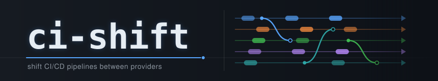
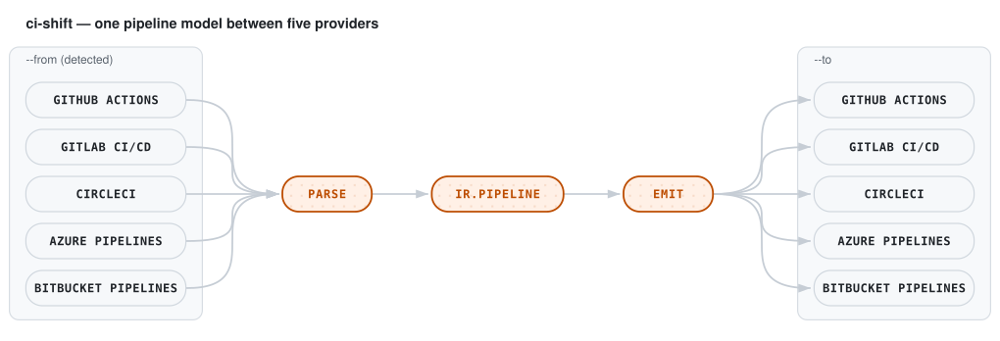
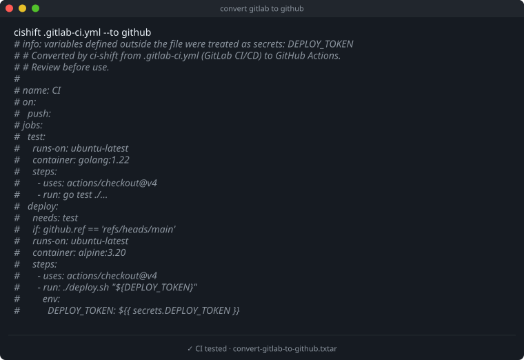
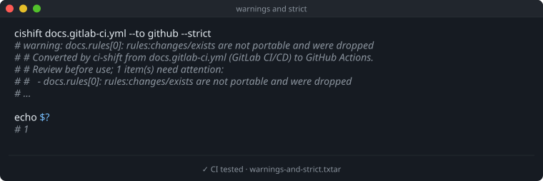
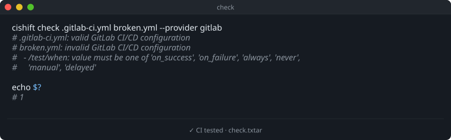
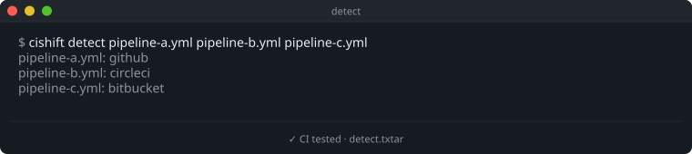
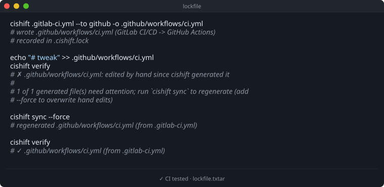

<div align="center">
  <picture>
    <source media="(prefers-color-scheme: dark)"  srcset="docs/assets/banner-dark.svg">
    <source media="(prefers-color-scheme: light)" srcset="docs/assets/banner-light.svg">
    
  </picture>

  <p><b>Translate CI/CD pipelines between GitHub, GitLab, CircleCI, Azure and Bitbucket, and check them against each provider's schema.</b></p>

  [](https://github.com/viniciusdc/ci-shift/actions/workflows/ci.yaml)
  [](go.mod)
  [](LICENSE)
  [](https://github.com/viniciusdc/ci-shift/releases)

</div>

`cishift` translates pipeline configurations from one CI provider to another
and checks them against each provider's official JSON schema.

| Provider | Name | Default file |
|---|---|---|
| GitHub Actions | `github` | `.github/workflows/ci.yml` |
| GitLab CI/CD | `gitlab` | `.gitlab-ci.yml` |
| CircleCI | `circleci` | `.circleci/config.yml` |
| Azure Pipelines | `azure` | `azure-pipelines.yml` |
| Bitbucket Pipelines | `bitbucket` | `bitbucket-pipelines.yml` |

## How it works

<div align="center">
<picture>
  <source media="(prefers-color-scheme: dark)" srcset="docs/assets/diagrams/how-it-works-dark.svg">
  
</picture>
</div>

Every provider converts to and from every other one. Instead of writing a
converter for each pair, each provider has a parser into a shared pipeline
model (`ir.Pipeline`) and an emitter back out of it. The source provider is
detected from the file unless you pass `--from`. See
[docs/translation.md](docs/translation.md) for what the model carries.

## Install

```bash
go install github.com/viniciusdc/ci-shift/cmd/cishift@latest
# or download a binary from the GitHub releases page, or from a checkout:
make build && ./cishift --help

cishift version --check   # is there a newer release?
```

## Usage

Give a file and a target; the source provider is detected:

<!-- gendocs:example:convert-gitlab-to-github -->
<div align="center">
<a href="testdata/examples/convert-gitlab-to-github.txtar"><picture>
  <source media="(prefers-color-scheme: dark)"  srcset="docs/assets/examples/convert-gitlab-to-github-dark.svg">
  <source media="(prefers-color-scheme: light)" srcset="docs/assets/examples/convert-gitlab-to-github-light.svg">
  
</picture></a>
</div>
<!-- /gendocs:example:convert-gitlab-to-github -->

```bash
# Write the result to a file (and record it in .cishift.lock)
cishift .gitlab-ci.yml --to github -o .github/workflows/ci.yml

# Check the result against the target schema; fail on lossy conversions
cishift .circleci/config.yml --to azure --check --strict

# Read from stdin
cat bitbucket-pipelines.yml | cishift - --from bitbucket --to gitlab

cishift providers
```

`cishift convert <file> --to <provider>` and `cishift validate` still work
as aliases, for scripts that prefer explicit verbs.

Converted files start with a comment header naming the source. It also lists
every **warning**: anything ci-shift dropped or approximated, such as a
GitHub Marketplace action with no equivalent, or a GitLab `rules:changes`.
Warnings also go to stderr. `--strict` turns them into a non-zero exit code,
which is useful in CI:

<!-- gendocs:example:warnings-and-strict -->
<div align="center">
<a href="testdata/examples/warnings-and-strict.txtar"><picture>
  <source media="(prefers-color-scheme: dark)"  srcset="docs/assets/examples/warnings-and-strict-dark.svg">
  <source media="(prefers-color-scheme: light)" srcset="docs/assets/examples/warnings-and-strict-light.svg">
  
</picture></a>
</div>
<!-- /gendocs:example:warnings-and-strict -->

Steps that cannot be translated, such as third-party GitHub actions,
CircleCI orbs, Azure tasks or Bitbucket pipes, become a **failing
placeholder step**. A converted pipeline therefore never silently skips
work.

### Checking and detecting

`cishift check` validates files against their provider's schema, detecting
the provider unless you pass `--provider`, and exits 1 when any file is
invalid:

<!-- gendocs:example:check -->
<div align="center">
<a href="testdata/examples/check.txtar"><picture>
  <source media="(prefers-color-scheme: dark)"  srcset="docs/assets/examples/check-dark.svg">
  <source media="(prefers-color-scheme: light)" srcset="docs/assets/examples/check-light.svg">
  
</picture></a>
</div>
<!-- /gendocs:example:check -->

```bash
cishift check .github/workflows/*.yml
cishift check --latest .gitlab-ci.yml   # download the newest schemas first
```

`cishift detect` prints which provider a file is for, whatever its name:

<!-- gendocs:example:detect -->
<div align="center">
<a href="testdata/examples/detect.txtar"><picture>
  <source media="(prefers-color-scheme: dark)"  srcset="docs/assets/examples/detect-dark.svg">
  <source media="(prefers-color-scheme: light)" srcset="docs/assets/examples/detect-light.svg">
  
</picture></a>
</div>
<!-- /gendocs:example:detect -->

## Keeping generated files in sync

Writing a file with `-o` records how it was produced in `.cishift.lock`:
source, providers, cishift version, schema snapshot and content hashes.
Commit it. `cishift verify` then checks every recorded file offline and
fails when an output is missing or was edited by hand, when its source
changed, or when the installed cishift would now generate it differently.
`cishift sync` regenerates them, and refuses to overwrite hand edits unless
you pass `--force`:

<!-- gendocs:example:lockfile -->
<div align="center">
<a href="testdata/examples/lockfile.txtar"><picture>
  <source media="(prefers-color-scheme: dark)"  srcset="docs/assets/examples/lockfile-dark.svg">
  <source media="(prefers-color-scheme: light)" srcset="docs/assets/examples/lockfile-light.svg">
  
</picture></a>
</div>
<!-- /gendocs:example:lockfile -->

That makes `cishift verify` a good CI step when a repository keeps pipelines
for several providers generated from one source. `--no-lock` skips recording
a file. The lockfile format and the lookup rules are in
[docs/lockfile.md](docs/lockfile.md).

## Schemas

Every provider's JSON schema is built into cishift, so `check` works offline
and gives the same verdict on every machine. To use the providers' current
schemas instead:

```bash
cishift schemas          # which schema each provider uses (built-in or cached)
cishift schemas update   # download the current schemas into the user cache
cishift schemas reset    # go back to the built-in snapshots
cishift check --embedded file.yml   # ignore downloaded schemas for one check
```

Downloaded schemas are only used after an explicit `update`. No other
command goes online, except `version --check`.

## What gets translated

Triggers, jobs and their dependencies, runners and images, services,
matrices, steps, tool setup, caches, artifacts, conditions and variables,
including secrets and well-known CI variables such as `$CI_COMMIT_SHA` ⇄
`${{ github.sha }}` ⇄ `$CIRCLE_SHA1`. Variables that a pipeline references
but never defines are treated as secrets. The full table, with how each
concept maps between providers, is in [docs/translation.md](docs/translation.md).

### Known limits

- Includes and templates (`include:`, Azure `template:`, CircleCI orbs) are
  not resolved. Convert the referenced files separately.
- Provider-specific expressions that ci-shift cannot parse (e.g. GitHub
  `contains(...)` conditions or job outputs) are reported and dropped.
- Schedules on GitLab and Bitbucket live in project settings, so ci-shift
  tells you which cron expression to create there.

## Library use

```go
import (
	"github.com/viniciusdc/ci-shift/convert"
	"github.com/viniciusdc/ci-shift/schema"
)

from, _ := convert.Get("gitlab")
to, _ := convert.Get("github")
res, err := convert.Convert(data, from, to, convert.Options{Header: true})
// res.Output, res.Diagnostics, res.Pipeline (the IR)

issues, err := schema.Validate("github", res.Output, schema.Options{})
```

## CLI reference

Every command and flag is listed in [docs/CLI.md](docs/CLI.md), generated
from the live `--help` output.

## Development

```bash
make test       # unit, round-trip, cross-provider golden, schema and example tests
make lint       # golangci-lint
make golden     # regenerate golden outputs after an intentional change
make schemas    # refresh the schema snapshots built into the binary
make generate   # regenerate the banner, diagram, CLI reference, layout and examples
```

The examples in this README are `testdata/examples/*.txtar` scripts: `go
test` runs them against the built binary, and `make examples` renders them
into the images above (install [freeze](https://github.com/charmbracelet/freeze)
with `make install-tools`). The generators in `internal/tools/gen*` come from
the [docsmith](https://github.com/viniciusdc/docsmith) template and read
`docsmith.toml`; the Drift workflow fails when generated docs are out of
date.

Releases are cut by pushing a tag (`git tag v0.1.0 && git push --tags`):
the release workflow runs the tests and publishes binaries with GoReleaser.

Adding a provider means implementing `ir.Provider` (`Parse`, `Emit`,
`Detect`) in `providers/<name>`, registering it in `convert/convert.go`,
and adding its schema URL to `schema/schema.go`.

## Project layout

<!-- gendocs:layout -->
```
Makefile            Build, test, lint, schema and docs targets
cmd/                Executable entry points
  cishift/          cishift translates CI/CD pipelines between providers
convert/            convert wires the providers together: detection, parsing, emitting and…
docs/               CLI reference, lockfile and translation guides
  diagrams/         Diagram sources (TOML) for gendiagram
docsmith.toml       Configuration for the docs generators
go.mod              Module github.com/viniciusdc/ci-shift
internal/           Packages private to this module
  buildinfo/        buildinfo reports the version of the running cishift binary
  cli/              cli implements the cishift command line
  lockfile/         lockfile records which pipeline files cishift generated, from what, and…
  tools/            Maintenance commands, run through make
    genbanner/      Generates the README banner SVGs from docsmith.toml
    gendiagram/     Generates architecture diagram SVGs from TOML definitions
    gendocs/        Generates the CLI reference and project layout sections of the docs
    genexamples/    Generates executable documentation snippets
    updateschemas/  updateschemas refreshes the schema snapshots embedded in the schema…
  yamlx/            yamlx provides small helpers for reading YAML documents in an…
ir/                 ir defines ci-shift's provider-neutral pipeline model
providers/          One parser + emitter per CI provider
  azure/            azure converts Azure Pipelines YAML definitions to and from the IR
  bitbucket/        bitbucket converts Bitbucket Pipelines configurations to and from the IR
  circleci/         circleci converts CircleCI 2.1 configurations to and from the IR
  github/           github converts GitHub Actions workflows to and from the IR
  gitlab/           gitlab converts GitLab CI/CD configurations to and from the IR
schema/             schema validates CI configuration files against the providers'…
  snapshots/        Provider JSON schemas built into the binary
```
<!-- /gendocs:layout -->

## License

[Apache License 2.0](LICENSE). Third-party notices are in [NOTICE](NOTICE).
